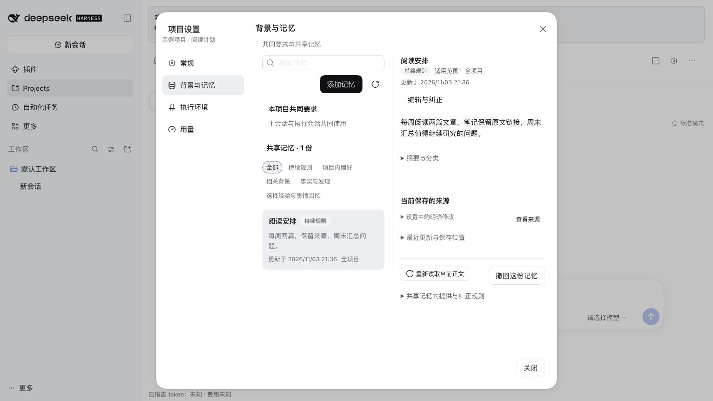

# DSH Projects

DeepSeek Harness 的本地项目协作插件，将多会话协作、长期上下文、聊天记录与共享记忆组织在同一个项目空间里。

长期工作需要在不同时间继续，多项工作也需要不同会话配合。Projects 围绕这两个问题组织信息：保留过去的背景与原话，让负责不同工作的会话能够通信、共享资料，并围绕同一个项目协作。

- **跨会话协作与持续推进**：通过主会话组织工作，多个执行会话分别承担任务；用户也可以直接进入执行会话讨论、修改和继续。
- **长期上下文与会话接力**：保持稳定的项目主入口，让后续会话能够读取当前背景、近期原文和历史信息。
- **聊天记录**：保存交流、工具调用与结果、会话间消息及来源，支持查询原话、前后文和长正文。
- **共享记忆**：按主题保存项目背景与历史线索，默认提供索引，正文按需读取；用户可以查看、编辑和纠正。

项目同时提供整体看板、资料与成果入口、会话定时任务及用量查看。用户决定方向、范围和重要取舍，Agent 按委托组织与执行工作。



图中内容为手动录入的示例，展示共享记忆的保存与回读。

## 版本与环境

当前预览版本为 `0.1.0-beta.3`。

本版变化、实际受测范围与已知限制见 [Release 说明](https://github.com/ZadAnthony/DSH-Projects/releases/tag/v0.1.0-beta.3)。构建检查与实际安装分别说明；不从历史版本推定本版全部通过。模型理解和实际使用效果尚未验证。

## 安装

插件包名为 `dsh-projects-zad`，提供 npm 和 GitHub Release 两种预编译安装包。准确版本及 SHA-256 校验值见 [Releases](https://github.com/ZadAnthony/DSH-Projects/releases/tag/v0.1.0-beta.3)，仓库源码链接不作直接安装入口。

**在 DSH「发现」页安装**：在 DSH `0.2.1-rc.5` 的 **插件 → 实验性插件 → 更多** 中启用 **自定义插件市场**，进入 **发现 → 添加索引源**，填入下面的项目索引地址，再搜索 **DSH Projects** 并确认安装。该索引由本项目维护，只列出本插件。

```text
https://raw.githubusercontent.com/ZadAnthony/DSH-Projects/main/market/index.json
```

DSH 默认没有配置目录，启用功能后仍需添加索引源。已有社区目录的收录和同步由该目录维护者负责；项目索引可以直接使用。发现页及安装行为见 [DSH 官方说明](https://github.com/deepseek-ai/deepseek-harness/blob/dsh-v0.2.1-rc.5/docs/user/guide/plugin-market.zh.md)。

**Desktop 直接安装**：在 DSH `0.2.1-rc.5` App 中打开 **插件 → 添加插件 → 安装第三方插件**，填写 `dsh-projects-zad@0.1.0-beta.3`，或粘贴以下 GitHub 安装包 URL；安装后点击 **立即启用**。正常退出并重开 App，在插件详情核对包名、`0.1.0-beta.3`、安装来源与运行状态。

```text
https://github.com/ZadAnthony/DSH-Projects/releases/download/v0.1.0-beta.3/dsh-projects-0.1.0-beta.3.tgz
```

**从旧包升级**：早期版本使用 `@local/dsh-projects`，与新包是不同的安装身份。先正常停止相关任务、退出宿主并备份资料，再沿正常管理器卸载旧包、安装新版，避免同时启用两者。正常卸载保留 Projects 数据；继续使用原 `dataRoot`，项目 ID 与存储格式不变。按 `id: dsh-projects` 保存的配置继续沿用；自定义 patch 若显式写了旧模块名 `@local/dsh-projects`，需同步改为 `dsh-projects-zad`。不要删除资料目录。

**Web**：准备 Node.js 24 和可在终端运行的 `pnpm`，先正常停止已有 Web 服务，再运行：

```sh
npx --yes @deepseek-ai/dsh@0.2.1-rc.5 plugin --profile web add dsh-projects-zad@0.1.0-beta.3
npx --yes @deepseek-ai/dsh@0.2.1-rc.5 web
```

打开终端给出的地址，从左侧 **Projects** 进入。后续启动只需第二条命令；终端按 `Ctrl+C` 正常停止服务，关闭浏览器页面不会停止后台。插件安装和启动遵循 DSH 的[官方安装合同](https://github.com/deepseek-ai/deepseek-harness/blob/b830ec950faba0a46dda564be3e2d854afed94f1/docs/user/develop/basic/publish.zh.md)与[CLI 说明](https://github.com/deepseek-ai/deepseek-harness/blob/b830ec950faba0a46dda564be3e2d854afed94f1/apps/cli/reference/README.zh.md)。

## 首次配置与使用

1. 在 DSH **设置 → 模型**中配置提供商、凭据和可用模型，详见[官方模型配置说明](https://github.com/deepseek-ai/deepseek-harness/blob/b830ec950faba0a46dda564be3e2d854afed94f1/docs/user/guide/providers.zh.md)。工作会话在各自的模型选择器中选模型。
2. 为 Projects 配置两个后台模型：`memoryModel` 用于共享记忆整理，`sessionManagerModel` 用于主会话接力判断。两者可以使用同一个可用模型，需分别填写。
3. 创建项目，填写名称并按需选择工作区。在主会话说明目标、范围和需要完成的工作；需要时进入执行会话直接交流。创建空会话本身不会启动模型工作。

后台模型配置写入当前端所用 profile 的 `cordis.patch.yml`。可从 DSH **设置 → 模型 → 打开配置文件**进入；默认 Web 文件为 `~/.dsh/profiles/web/cordis.patch.yml`，Desktop 为 `~/.dsh/profiles/desktop/cordis.patch.yml`。若自定义了 `DSH_HOME`，将 `~/.dsh` 替换为实际目录。

将以下条目加入现有 YAML 列表；若已存在 `id: dsh-projects`，修改该条目，保留其他配置。示例中的 provider 和 model 必须替换为 DSH 实际配置的 **ID**，而非显示名称：

```yaml
- id: dsh-projects
  config:
    dataRoot: !!js dshHomePath('projects-stock')
    memoryModel:
      provider: "替换为提供商ID"
      model: "替换为记忆模型ID"
    sessionManagerModel:
      provider: "替换为提供商ID"
      model: "替换为接力判断模型ID"
```

**`config` 会整体替换，不会逐字段合并。** 必须保留 `dataRoot` 及已有的其他必要字段。默认数据目录是当前 `DSH_HOME` 下的 `projects-stock`；修改 `dataRoot` 只会切换读取位置，不会迁移旧资料。保存后正常重启当前端。

模型凭据继续由 DSH 管理，不写入上面的 Projects 配置。缺少专用后台模型时，界面会提示；主会话与执行会话仍可使用，自动记忆整理和接力判断无法正常运行，插件不会自行改用工作会话模型。

## 数据与调用成本

- 项目记录与记忆保存在本机；调用所选模型时，相关请求上下文会发送给对应服务。工作会话、记忆整理和接力判断都可能产生模型费用，具体取决于你的提供商与账户。
- 本地后台停止或关机后不再执行定时任务。Web 与 Desktop 使用同一数据目录时，先正常退出一端，再使用另一端。
- 更新或卸载插件保留项目数据。备份应包含完整 `dataRoot`；外部工作区和引用文件保留在原位置，需另行备份。永久删除项目会删除其自有内容，请先确认范围。
- 用量界面展示实际可得的报告；缺报显示未知，不等同于零费用或完整账单。当前没有经过验证的 Token、缓存、费用或耗时收益承诺。

## 开发与反馈

源码构建、依赖准备和检查步骤见 [BUILDING.md](https://github.com/ZadAnthony/DSH-Projects/blob/main/BUILDING.md)。安装预构建包不需要本仓库源码或 SDK。

通过 [Issues](https://github.com/ZadAnthony/DSH-Projects/issues) 反馈问题。请提供插件版本、DSH 版本、操作系统与架构、Web／Desktop、复现步骤和实际结果；日志与截图请先移除密钥及私人资料。

项目代码采用 [MIT License](https://github.com/ZadAnthony/DSH-Projects/blob/main/LICENSE)。复用源码及依赖的许可和来源见 [THIRD_PARTY_NOTICES.md](https://github.com/ZadAnthony/DSH-Projects/blob/main/THIRD_PARTY_NOTICES.md)。
